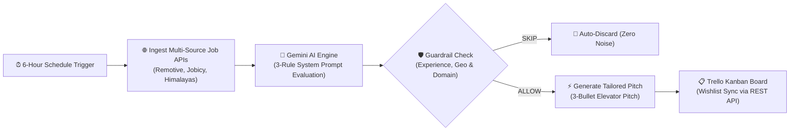

# ⚡ Autonomous GTM & AI Agentic Workflow Engine

> An enterprise-grade, self-healing GTM (Go-To-Market) & Career Auto-Pilot engine built using **n8n**, **Gemini 2.5/Flash AI**, **Python**, and **Trello REST APIs**.

[](https://n8n.io)
[](https://ai.google.dev)
[](https://python.org)
[](https://trello.com)

---

## 🧭 Architecture Overview



---

## 🔥 Key Features & Capabilities

1. **Autonomous Scraping & Multi-API Ingestion:**
   - Ingests real-time remote job feeds across global APIs (Remotive, Jobicy, Himalayas, Y-Combinator network).
   - Validates live HTTP 200 OK statuses on every external application URL to prevent 404 links.

2. **Intelligent AI Guardrail Filter (Gemini Flash Engine):**
   - **Rule 1 (Experience Cap):** Hard limits to 0–3 Years (APM, Junior PM, Growth/GTM Internships). Rejects 4+, 5+, 7+ yrs & Senior/Staff roles.
   - **Rule 2 (Geographic Eligibility):** Accepts only *Worldwide Remote* or *Remote - India*. Auto-discards US-only, UK-only, or EU local office constraints.
   - **Rule 3 (Domain Alignment):** Filters for fast-paced Startups, SaaS, AI tools, and automation workflows. Rejects legacy enterprise banking ledgers.

3. **Custom Pitch & Kanban Automation:**
   - Automatically writes a 3-bullet personalized elevator pitch for every candidate-job pair.
   - Pushes clean cards directly into the Trello `Wishlist` list via REST API webhooks.

---

## 🛠️ Tech Stack

- **Orchestration:** n8n (Self-Hosted on Docker / Coolify)
- **AI Model:** Google Gemini AI API (`models/gemini-flash-latest`)
- **Backend Scripting:** Python 3.9+ (Custom HTTP Webhook handlers & Data Sanitizers)
- **Database / UI Sync:** Trello REST API (Automated Board & Card Lifecycle Management)

---

## 🚀 Quick Setup & Usage

1. **Clone the Repository:**
   ```bash
   git clone https://github.com/YOUR_USERNAME/gtm-n8n-agentic-engine.git
   cd gtm-n8n-agentic-engine
   ```

2. **Import Workflow to n8n:**
   - Open your n8n Dashboard -> **Workflows** -> **Import from File**.
   - Select `workflows/job_hunter_autopilot.json`.

3. **Configure Environment Variables:**
   - Replace `{{GEMINI_API_KEY}}` with your Google AI Studio key.
   - Replace `{{TRELLO_API_KEY}}`, `{{TRELLO_TOKEN}}`, and `{{TRELLO_WISHLIST_LIST_ID}}`.

4. **Activate & Run:**
   - Click **Publish** to enable 24/7 background automation.

---

## 📜 License
Licensed under the [MIT License](LICENSE). Built with 💡 by Mangal.
