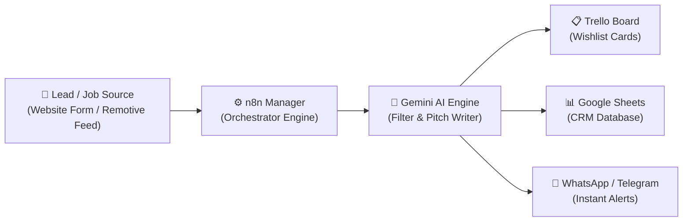
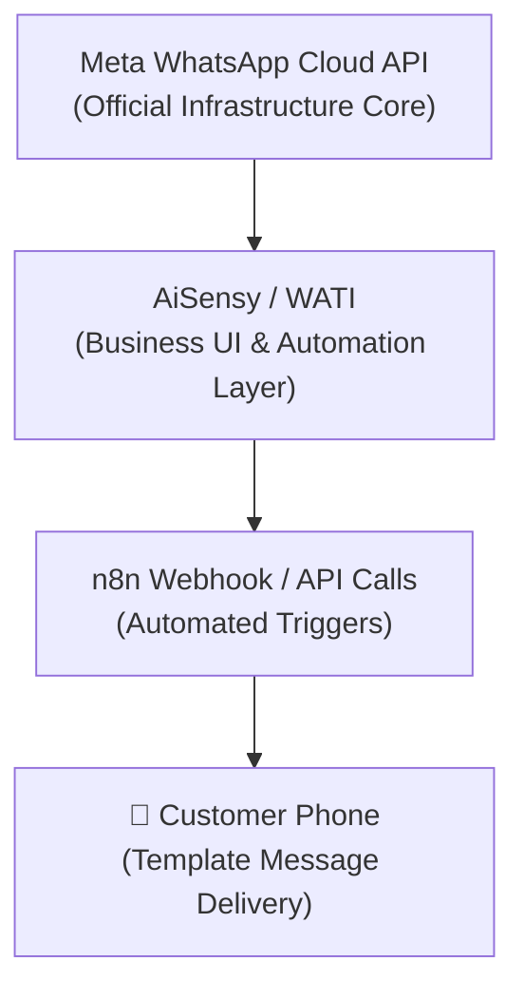

# 🚀 TrackKaro AI — Complete GTM & Career Auto-Pilot Architecture Guide

> **Author:** Mangal Soren  
> **System Name:** TrackKaro AI Engine (n8n + Gemini AI + Trello + Google Sheets + Meta WhatsApp + Telegram)  
> **Purpose:** Master reference guide to understand, present, and explain every single concept, tool, API, and deployment component of your automation engine in a simple story format.

---

## 📖 Table of Contents
1. 💡 [The Story & Core Problem](#1--the-story--core-problem)
2. ⚙️ [n8n Engine — The Control Room (Manager)](#2--n8n-engine--the-control-room-manager)
3. 🔗 [APIs, Webhooks & JSON — The Communication Bridge](#3--apis-webhooks--json--the-communication-bridge)
4. 🤖 [Google Gemini AI Engine — The Smart Filter & Pitch Generator](#4--google-gemini-ai-engine--the-smart-filter--pitch-generator)
5. 📊 [Google Sheets & Apps Script — The Data Vault](#5--google-sheets--apps-script--the-data-vault)
6. 📋 [Trello Kanban Board — Visual Workflow Management](#6--trello-kanban-board--visual-workflow-management)
7. 💬 [WhatsApp Integration — Meta Cloud API vs AiSensy vs WATI](#7--whatsapp-integration--meta-cloud-api-vs-aisensy-vs-wati)
8. 🏢 [Meta Business Manager & WABA Setup](#8--meta-business-manager--waba-setup)
9. 📲 [Telegram Bots — Instant Alert System](#9--telegram-bots--instant-alert-system)
10. 🌐 [Infrastructure — VPS, Docker, Coolify, Domains & SSL](#10--infrastructure--vps-docker-coolify-domains--ssl)
11. 📊 [React Telemetry Console & Dashboard](#11--react-telemetry-console--dashboard)
12. 💼 [Interview Pitch & Cheat Sheet (60-Second Explanation)](#12--interview-pitch--cheat-sheet-60-second-explanation)

---

## 1. 💡 The Story & Core Problem

### 🎭 The Real-World Story:
Maan le tune ek company start ki **TrackKaro AI**. 

Website par roz 100 naye customers aate hain aur form bharte hain:
> *"Hi, mera naam Rahul hai, mera phone 9876543210 hai, mujhe Product Management/Website Development service chahiye."*

**The Problem Without Automation:**
1. Form bharne ke baad kisi customer ko instant reply nahi milta (Lead cold ho jata hai).
2. Sales team ko pata hi nahi chalta ki naya lead aaya hai.
3. Customer ka data Excel / Google Sheets mein **manually copy-paste** karna padta hai.
4. Jobs / Leads dhoondhne aur filter karne mein roz 4-5 ghante barbaad hote hain.

**The Solution — TrackKaro AI Auto-Pilot:**
Tune socha: *"Ye poora repetitive manual kaam automatically kyun nahi ho sakta?"*



---

## 2. ⚙️ n8n Engine — The Control Room (Manager)

### 🏬 Simple Story Analogy:
Soch **n8n** tere office ka **General Manager** hai.
- Manager khud database nahi hai, na hi khud WhatsApp hai.
- Manager decide karta hai ki **kaunsa kaam kis order mein hoga**.

```
Step 1: Naya Lead / Job Feed aaya.
Step 2: Split Jobs Array node data ko ek-ek item me baant ta hai.
Step 3: Gemini AI node prompt evaluate karke Pitch banata hai.
Step 4: IF Node filter karta hai (SKIP wale job reject, relevant job ALLOW).
Step 5: Parallel Push -> Trello Card banata hai & Google Sheet update karta hai.
```

### 🧱 n8n Terminology:
- **Workflow:** Poora end-to-end automation chart.
- **Node:** Workflow ka ek specific step (e.g., HTTP Request Node, Code Node, IF Node, Trigger Node).
- **Trigger:** Wo event jo workflow ko start karta hai (e.g., `Every 6 Hours Schedule Trigger` ya `Webhook Trigger`).
- **Parallel Execution:** Jab ek Node ki output line 2 alag nodes se ek saath connect hoti hai (e.g., Trello + Google Sheets).

---

## 3. 🔗 APIs, Webhooks & JSON — The Communication Bridge

### 🛎️ Analogy Table:

| Technical Term | Simple Story Example | Real Usage in TrackKaro AI |
| :--- | :--- | :--- |
| **API** | Restaurant ka Menu & Waiter | External service se data mangwane ka rulebook |
| **Webhook** | Reception ki Doorbell | Website par form bhartay hi n8n ko alert bhejna |
| **Endpoint (URL)** | Office ka Address | `https://script.google.com/macros/s/.../exec` |
| **HTTP Method (POST)** | Application Form Submit karna | Server ko naya data bhejti hai |
| **HTTP Method (GET)** | Noticeboard Se Data Padhna | Remotive API se jobs fetch karna |
| **Header** | Visitor ID Card | `Content-Type: application/json` |
| **API Key / Token** | Office ki Digital Key | `AQ.Ab8RN6KBM...` (Gemini API Key) |
| **JSON Body** | Application Letter ka Content | `{ "name": "Rahul", "phone": "9876..." }` |
| **HTTP Response** | Receipt / Confirmation Stamp | `200 OK` (Success), `400 Bad Request` (Error) |

### 📄 JSON (JavaScript Object Notation):
Software systems aapas mein Hindi/English mein baat nahi karte, wo JSON mein baat karte hain:

```json
{
  "company": "Unio Digital",
  "jobTitle": "APM / Product Operations",
  "location": "Worldwide Remote",
  "status": "Wishlist"
}
```

---

## 4. 🤖 Google Gemini AI Engine — The Smart Filter & Pitch Generator

### 🎯 Role in System:
Gemini AI system ka **Smart HR & Recruiter** hai. 

#### System Prompt & Guardrails:
1. **Seniority Cap:** 10+ Yrs / VP / Director level roles reject (SKIP) karna. APM, Junior PM, Product Ops, Growth, GTM, Founder's Office allow karna.
2. **Location Guardrail:** Physical in-person office mandatory roles reject (SKIP). Worldwide Remote / Remote India allow karna.
3. **Domain Guardrail:** Nursing, physical sports, heavy hardware reject. AI, SaaS, Startup, Operations allow karna.
4. **Elevator Pitch Generation:** Allow hone par candidate ke liye 3-bullet customized elevator pitch likhna.

#### ⚙️ Rate Limit & Speed Pacing (RPM vs RPD):
- **RPM (Requests Per Minute):** Google AI Studio Free Tier par 15 requests/minute allowed hoti hain. Isiliye n8n mein `Batch Interval = 4.5 Seconds` pacing add ki gayi hai.
- **RPD (Requests Per Day):** Models like `gemini-3.5-flash-lite` have generous daily limits (1,500 requests/day).
- **Retry On Fail:** Agar Google 20-second pause bole (`429 Rate Limit`), n8n automatically 5 second wait karke restart kar leta hai.

---

## 5. 📊 Google Sheets & Apps Script — The Data Vault

### 📝 Architecture:
TrackKaro AI mein 2 tarike hain Google Sheets ko update karne ke:

#### Method A: Google Apps Script Webhook (Used & Deployed)
Instead of setting up complex Google Cloud OAuth Client IDs/Secrets in n8n, humne **Google Apps Script** deploy kiya:

```javascript
function doPost(e) {
  try {
    var sheet = SpreadsheetApp.getActiveSpreadsheet().getSheetByName("Sheet1") 
                || SpreadsheetApp.getActiveSpreadsheet().getSheets()[0];
    var data = JSON.parse(e.postData.contents);
    
    if (sheet.getLastRow() === 0) {
      sheet.appendRow(["Date Added", "Company", "Job Title", "Location", "Job URL", "Status", "AI Pitch"]);
    }
    
    // Formula Escape Guard: Agar text '=', '+', ya '-' se start ho toh Sheets usse formula na samjhe
    var aiPitch = (data.aiPitch || "").toString().trim();
    if (aiPitch.startsWith("=") || aiPitch.startsWith("+") || aiPitch.startsWith("-") || aiPitch.startsWith("@")) {
      aiPitch = "'" + aiPitch; // Prefixing with single quote forces Sheets to render as pure text
    }
    
    sheet.appendRow([
      data.dateAdded || new Date().toLocaleString(),
      data.company || "",
      data.jobTitle || "",
      data.location || "",
      data.jobUrl || "",
      data.status || "Wishlist",
      aiPitch
    ]);
    
    return ContentService.createTextOutput(JSON.stringify({ result: "success" }))
      .setMimeType(ContentService.MimeType.JSON);
  } catch (err) {
    return ContentService.createTextOutput(JSON.stringify({ result: "error", message: err.toString() }))
      .setMimeType(ContentService.MimeType.JSON);
  }
}
```

**Why Apps Script Webhook is Brilliant:**
- No OAuth expiration / refresh token headaches.
- Simple `HTTP POST` request from n8n to the Web App URL instantly appends new rows!

---

## 6. 📋 Trello Kanban Board — Visual Workflow Management

### 📌 Role in System:
Trello project ka **Visual Kanban Tracker** hai.

- **Board:** Job Applications Tracker.
- **List:** `Wishlist` (Filtered relevant jobs).
- **Cards:** Har Card ka Title = `🔥 Job Title - Company Name`.
- **Card Description:** Includes Job URL, Location, Profile Fit, and Gemini AI's 3-bullet customized pitch!

---

## 7. 💬 WhatsApp Integration — Meta Cloud API vs AiSensy vs WATI

### 🔍 Concept Breakdown:



1. **Meta WhatsApp Business Cloud API:**
   - Meta ka official underlying messaging platform. Direct API calls se messages send/receive kar sakte hain.
2. **AiSensy:**
   - WhatsApp marketing platform built on top of Meta API. Includes broadcast dashboard, template manager, and chatbot builder.
3. **WATI (WhatsApp Team Inbox):**
   - Customer support and team inbox platform built on WhatsApp Cloud API.

### ❓ Difference between WATI and AiSensy:
Dono similar WhatsApp Business Solution Providers (BSPs) hain. Business apni need ke hisab se kisi ek ko choose karta hai. (Projects mein baseline concept test and evaluate kiya jata hai).

---

## 8. 🏢 Meta Business Manager & WABA Setup

### 🔗 Meta Link: `https://business.facebook.com/latest/home?business_id=1084957347696968`

### 🔑 Key Assets in Meta Business Suite:
1. **Business Portfolio (Business ID):** Main account jo saare assets, pages, aur ad accounts ko control karta hai.
2. **WhatsApp Business Account (WABA):** WhatsApp messaging API account.
3. **Phone Number ID:** API in calls mein target phone number ki unique ID.
4. **Permanent System User Access Token:** Authentication key jo n8n HTTP Request node mein header mein paas hoti hai:
   `Authorization: Bearer EAAG...`
5. **Message Templates:** Meta se pre-approved template messages (e.g. `hello_world` or custom lead response templates).

---

## 9. 📲 Telegram Bots — Instant Alert System

### 🤖 Role:
n8n manager jab bhi koi high-priority lead ya filtered job find karta hai, wo **Telegram Bot API** through team group ya candidate phone par instant alert bhejta hai.

- **BotFather:** Telegram ka bot creator.
- **Bot Token:** Authentication key for sending messages.
- **Chat ID:** Specific user ya group ID jahan message send hona hai.

---

## 10. 🌐 Infrastructure — VPS, Docker, Coolify, Domains & SSL

### 🏗️ Complete Tech Stack:

```
[ Domain: n8n.trackkaroai.com ]
             │
             ▼
[ Reverse Proxy: Traefik / SSL Let's Encrypt (Port 443) ]
             │
             ▼
[ VPS Server (Linux Ubuntu) + Coolify PaaS Orchestrator ]
             │
             ▼
[ Docker Container: n8n Engine (Port 5678) ]
```

1. **VPS (Virtual Private Server):** Linux Cloud Computer jo 24/7 internet se connected rehta hai.
2. **Docker Container:** n8n software ko isolated container environment mein run karta hai.
3. **Coolify (Self-Hosted PaaS):** Open-source alternative to Heroku/Vercel. Manages Docker containers, deployments, environment variables, and domains.
4. **Domain & Subdomain (`n8n.trackkaroai.com`):** DNS A Record points domain name to VPS IP Address.
5. **SSL/HTTPS (Let's Encrypt):** Encrypts web traffic between browser and server (`https://`).
6. **Internal Port (`5678`):** Container ke andar n8n port 5678 par chalta hai, jise Traefik reverse proxy HTTPS Port 443 par expose karta hai.

---

## 11. 📊 React Telemetry Console & Dashboard

### 🖥️ Role:
A custom **React-based Telemetry Dashboard** built to monitor execution logs, API response statuses, lead throughput, and error rates visually in real-time.

- **Frontend:** React + Tailwind CSS / Vanilla CSS.
- **Data Flow:** n8n execution webhooks -> Telemetry Dashboard API -> Live UI Cards & Graphs.

---

## 12. 💼 Interview Pitch & Cheat Sheet (60-Second Explanation)

### 🎙️ 60-Second Interview Pitch:

> *"I built TrackKaro AI as a self-hosted GTM & Career Auto-Pilot engine to automate high-volume lead ingestion and job evaluation.*
> 
> *Architecturally, the system ingests live data feeds via REST APIs and Webhooks into a self-hosted n8n instance running inside a Docker container on a Linux VPS. Incoming data is split and sanitized using JavaScript nodes and passed to the Google Gemini AI engine, where a custom system prompt enforces guardrails around seniority, geographic eligibility, and domain alignment while generating tailored pitches.*
> 
> *For leads passing the guardrails, n8n executes parallel output streams — pushing visual Kanban cards to Trello via REST API and appending structured CRM data to Google Sheets via a custom Google Apps Script Webhook. The entire infrastructure is orchestrated using Coolify with automated SSL termination over HTTPS."*

---

### 🧠 Quick Revision Terminology Table:

| Term | 1-Line Definition |
| :--- | :--- |
| **n8n** | Self-hosted visual workflow automation engine |
| **Node** | An individual building block/step inside an n8n workflow |
| **Webhook** | An HTTP endpoint that listens for event-driven incoming data |
| **REST API** | Standardized rules for two software applications to communicate |
| **JSON** | Lightweight structured text format for data exchange |
| **Gemini AI** | Google's LLM engine used for JD filtering and elevator pitch writing |
| **Google Apps Script** | Cloud JS script running inside Google Workspace for automated sheet appending |
| **WABA** | Official WhatsApp Business Account ID in Meta Business Suite |
| **Coolify** | Open-source self-hosted PaaS used to orchestrate Docker containers on VPS |
| **SSL/HTTPS** | Encrypted web security certificate issued via Let's Encrypt |

---
*Maintained by Mangal Soren | TrackKaro AI System Architecture Guide*
